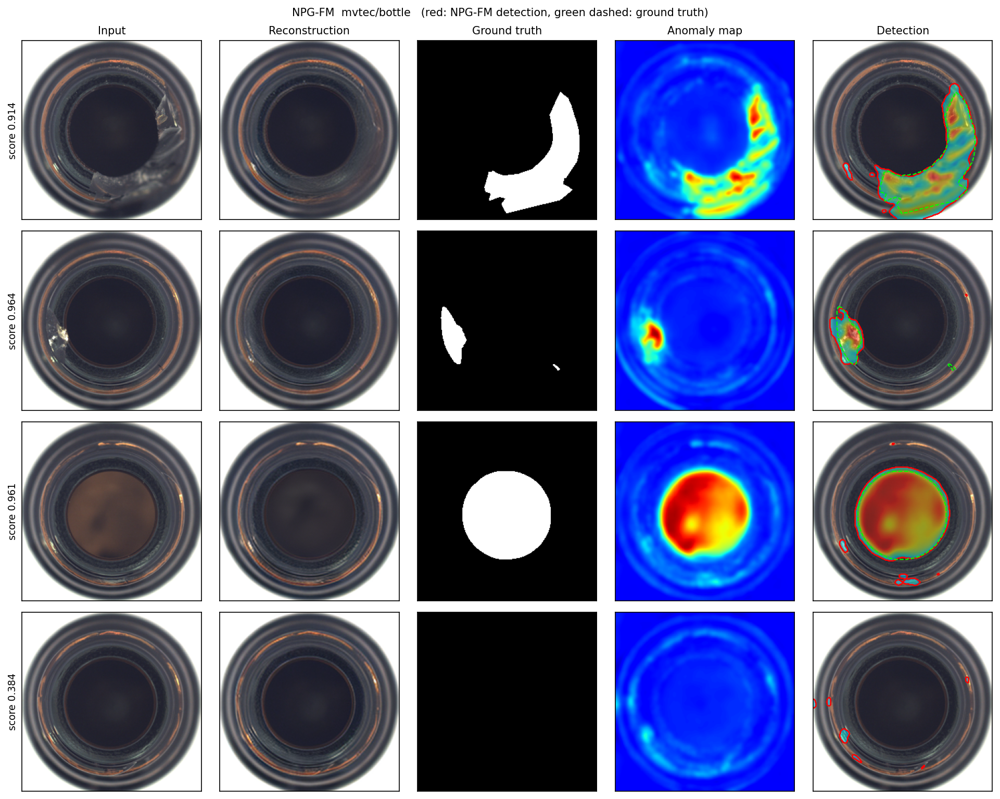

# NPG-FM

**Normal-Prototype-Guided Flow Matching** for multi-class unsupervised anomaly detection.
One model handles every product class. It finds defects by moving an image's latent toward the
normal data distribution and measuring what had to change.



## How it works

```
x ──E──► z ──(+ λ·p_c)──► z_in ──ODE(v_θ, N steps)──► ẑ ──D──► x̂
                                                         │
                         anomaly map A = sqrt( |x̂ − D(z)| ⊙ |ẑ − z| )   (blurred, upsampled)
```

| Part | Description |
|---|---|
| `E`, `D` | Frozen SD-VAE (`stabilityai/sd-vae-ft-ema`), 256×256 image → 4×32×32 latent |
| `p_c` | Normal prototypes of class `c`: k-means (K = 5) on the latents of normal training images. The real latent nearest each centroid is kept. |
| `λ` | Prototype routing weight (0.1). A random prototype of the class is added before integration. |
| `v_θ` | Class-conditional U-Net (395 M params) that predicts the *direction of deviation* from normality |
| ODE | Deterministic N-step integration (default N = 10) that removes the deviation |
| Score | Image score = max of the anomaly map |

## Setup

```bash
pip install -r requirements.txt
```

Datasets: [MVTec-AD](https://www.mvtec.com/company/research/datasets/mvtec-ad) and
[VisA](https://amazon-visual-anomaly.s3.us-west-2.amazonaws.com/VisA_20220922.tar). Put them under `data/`:

```
data/mvtec/bottle/train/good/000.png ...
data/visa/candle/Data/Images/Normal/0000.JPG ...
```

The train/test lists are in `splits/`.

Weights: download `npgfm_mvtec.pt` (1.6 GB) from the [Releases](../../releases) page into `checkpoints/`.
The file holds the U-Net, the class prototypes and the config. The VAE is downloaded from Hugging Face automatically.

## Usage

```bash
# evaluate on all 15 MVTec classes
python evaluate.py --dataset mvtec --data-dir data/mvtec --ckpt checkpoints/npgfm_mvtec.pt

# visualise detections on the test set: input | reconstruction | ground truth | anomaly map | detection
python visualize.py --data-dir data/mvtec --category bottle --num 6        # one class
python visualize.py --data-dir data/mvtec --category all                   # every class -> vis/

# visualise your own images of a known class (threshold calibrated on normal training images)
python visualize.py --images my_bottle_1.png my_bottle_2.png --category bottle

# train (single GPU, or torchrun --nproc_per_node 2 train.py ...)
python train.py --dataset mvtec --data-dir data/mvtec --out-dir runs/npgfm
```

In Python:

```python
import torch
from npgfm import NPGFM

model = NPGFM.from_pretrained('checkpoints/npgfm_mvtec.pt').cuda()
x = torch.rand(1, 3, 256, 256).cuda() * 2 - 1           # image in [-1, 1]
cls = torch.tensor([1]).cuda()                            # class index (see npgfm/data.py: CLASSES)
out = model(x, cls)                                       # anomaly_map (B,256,256), score (B,), reconstruction
```

## Results (MVTec-AD, `checkpoints/npgfm_mvtec.pt`, N = 10)

| I-AUROC | I-AP | I-F1max | P-AUROC | P-AP | P-F1max | AUPRO |
|:-:|:-:|:-:|:-:|:-:|:-:|:-:|
| 96.2 | 98.7 | 96.1 | 95.7 | 67.5 | 64.6 | 88.6 |

Mean over the 15 classes, measured on one RTX 5090 with seed 0. Results vary slightly between runs because the routed prototype is chosen at random.

Per-class numbers: `python evaluate.py --out results.json`.

## Repository layout

```
npgfm/
  model.py     NPGFM: encode → prototype routing → deviation ODE → decode → anomaly map
  unet.py      class-conditional latent U-Net v_θ
  flow.py      schedule, training loss and ODE sampler
  data.py      MVTec-AD / VisA loader
  metrics.py   I-/P-AUROC, AP, F1-max, AUPRO
train.py  evaluate.py  visualize.py
tools/convert_checkpoint.py   legacy checkpoint → NPG-FM checkpoint (+ prototypes)
splits/                       dataset file lists
```

## Acknowledgement

The U-Net and the deviation-diffusion formulation build on
[DeCo-Diff](https://github.com/farzad-bz/DeCo-Diff) (CVPR 2025, MIT license) and
[latent diffusion](https://github.com/CompVis/latent-diffusion).
